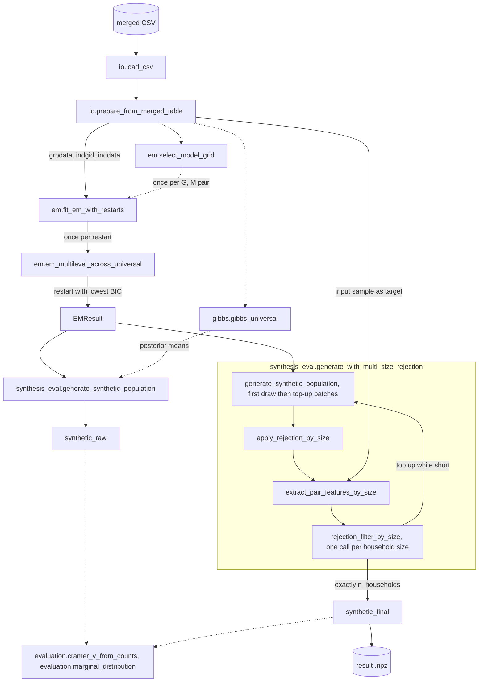

# hlc-popsyn

[](https://github.com/Zhuhan-J/hlc-popsyn/actions/workflows/ci.yml)

I ported the hierarchical mixture (hierarchical latent class, HLC) model for population synthesis
by Sun, Erath and Cai (2018) from the authors' MATLAB code to Python. The package fits household
and individual latent classes to a sample of households and their members, generates a synthetic
population, and filters it with a rejection step that corrects relationships between members of
the same household. It is an independent port, and the original authors do not maintain it.

## The original method

The method is described in Lijun Sun, Alexander Erath and Ming Cai, "A hierarchical mixture
modeling framework for population synthesis", Transportation Research Part B 114 (2018), 199-212,
[doi:10.1016/j.trb.2018.06.002](https://doi.org/10.1016/j.trb.2018.06.002). Lijun Sun's MATLAB
code is at
[mcgill-smart-transport/population_synthesis_hierarchical](https://github.com/mcgill-smart-transport/population_synthesis_hierarchical)
(MIT License).

All attributes are categorical. Each household belongs to one of $G$ household classes, and given
its class, each household attribute (household size included) follows its own categorical
distribution. Each member belongs to one of $M$ individual classes, with weights that depend on
the household class. The individual classes are universal: all household classes share their
attribute distributions. For household $i$ with household attributes $x_{ik}$, $k = 1, \dots, h$,
and members $j = 1, \dots, n_i$ with attributes $x_{ijk}$, $k = h+1, \dots, K$,

```math
p(\mathbf{x}_i) = \sum_{g=1}^{G} \lambda_g \prod_{k=1}^{h} \phi^{(k)}_{x_{ik} g} \prod_{j=1}^{n_i} \sum_{m=1}^{M} \mu_{gm} \prod_{k=h+1}^{K} \theta^{(k)}_{x_{ijk} m}
```

In the code, `pi_g` and `pi_m` hold $\lambda$ and $\mu$, and `log_phi_g` and `log_phi_m` hold
$\log\phi$ and $\log\theta$. The parameters are estimated by EM from several random starts, and
$G$ and $M$ are chosen by $\mathrm{BIC} = -2\log L + D_f \log n$, where $n$ is the number of
individuals, $d_k$ is the number of categories of attribute $k$, and

```math
D_f = (G-1) + G(M-1) + G\sum_{k=1}^{h}(d_k - 1) + M\sum_{k=h+1}^{K}(d_k - 1)
```

A synthetic household is drawn by sampling its class and household attributes, then as many
members as its household-size attribute gives, each with an individual class and attributes.
Members are independent given the household class, so pairs such as couples are not reproduced
well. For two-person households the paper adds a rejection step. Let $y_1$ be the absolute age
difference and $y_2$ the absolute sex difference of the two members, $f_1$ their distribution in
the synthetic population and $f_2$ their distribution in the sample. A household is accepted with
probability

```math
\alpha_i = \frac{f_2(y_{i1}, y_{i2})}{c \, f_1(y_{i1}, y_{i2})}, \qquad c = \max_{y_1, y_2} \frac{f_2(y_1, y_2)}{f_1(y_1, y_2)}
```

The paper names this constant $M$. I write $c$ to keep $M$ for the number of individual classes,
but the diagnostics printed by the code still call it `M`.

## What I implemented and changed

I translated the universal-class EM (`EM_multilevel_across.m`), the parameter count, BIC and
restarts (`run_multilevel_1.m`), the generator (`run_create_2.m`), the rejection step
(`run_two_within_the_same_4.m`), Cramér's V and the MATLAB and MEX helpers into a Python package
with a command-line tool, `hm-popsyn-run`. Category codes stay 1-based, as in MATLAB. On top of
the port I made these changes:

1. Rejection covers every household size of two or more, with separate target and proposal
   distributions for each size. A household's features are the mean absolute differences between
   its first listed member and each other member; for two-person households this is the paper's
   pairwise difference. I measure the age difference in ordinal age positions grouped into 5
   bins, and I use the difference between coarse employment groups in place of the sex
   difference.
2. I compute $c$ only over cells where both distributions are positive and cap it at 3, close to
   the value of 2.97 reported in the paper. Household sizes with fewer than 30 households in the
   sample skip the test, and all their households are kept.
3. `generate_with_multi_size_rejection` draws 1.5 times the requested number of households,
   applies rejection, and draws fresh top-up batches until exactly `n_households` households are
   accepted. It keeps the household-size mix of the first draw, and the output has no duplicated
   households.
4. `fit_em_with_restarts` keeps the restart with the lowest BIC, and `select_model_grid` searches
   a grid of $(G, M)$ values.
5. `gibbs_universal` is a Gibbs sampler adapted from `Gibbs_universal.m`, with symmetric
   Dirichlet priors in place of the MATLAB stick-breaking priors on the class weights. The
   pipeline does not use it.

Extensions I use in my own research are not part of this package.

### Model architecture and data flow



`hm-popsyn-run` (`runner.main`) follows the solid arrows. It loads and prepares the CSV, calls
`pipeline.fit_and_generate` for every step from `fit_em_with_restarts` to `synthetic_final`, and
writes the fitted parameters, the EM likelihood trace, the convergence flag and `synthetic_final`
to an `.npz` file. `synthetic_raw` is a separate draw without rejection that `fit_and_generate`
returns for comparison. Dashed arrows are functions you call yourself. EM uses `kernels.sum_eik`
and `kernels.logsumexp`.

## Same as the original, and different

| Component | Original MATLAB | This package | Status |
| --- | --- | --- | --- |
| Model with universal individual classes | `EM_multilevel_across.m` | `em.em_multilevel_across_universal` | Same |
| Model with class-specific individual classes | `EM_multilevel.m` | Not included | Not ported |
| EM start | Normalized Gamma(1, `con`) draws, or an optional tensor-factorization start | Normalized Gamma(1, `concentration`) draws only; in both versions the scale cancels after normalization, so it does not change the start | Tensor start dropped |
| E-step, M-step, log-likelihood | `EM_multilevel_across.m` | Same updates in the same order; floors values at 1e-12 where MATLAB adds machine epsilon | Same |
| Stopping rule | Relative change of the log-likelihood at most `tol`, checked from iteration 3; at most `maxIter - 1` iterations | Same rule, checked from iteration 2; at most `max_iter` iterations; adds a `converged` flag | Same rule |
| Parameter count and BIC | `run_multilevel_1.m`: best log-likelihood of the run, log of the number of individuals | `em.count_parameters_universal`, `em.bic_score` | Same |
| Restarts | 20 runs saved; `run_create_2.m` uses a run picked by hand | `em.fit_em_with_restarts` keeps the lowest BIC | Different |
| G and M search | Loads a precomputed `bic.mat`; the grid code is not in the repository | `em.select_model_grid` | Added |
| Gibbs sampler | Stick-breaking priors on class weights with resampled concentration parameters; returns every draw | Symmetric Dirichlet priors on all parameters; returns posterior means after burn-in and thinning, and class-label traces | Different |
| Input preparation | Sorts rows, shifts each column to a minimum of 1, computes household size from row counts and inserts it as the fourth household attribute | Same sort and shift; household size must already be a column and is shifted with the others; household ids are remapped to 1..N | Different |
| Generation | Household class, household attributes, members from the size attribute; member attributes from the class mixture; 10 times the number of sample households | Same distribution; draws and returns each member's class; generates `n_households` | Same model |
| Rejection scope | Two-person households, one pass, sample as target | Every size of two or more, one target and proposal per size, sample as target | Different |
| Rejection features | Absolute differences of the raw age and sex codes, plus 1 | Mean difference to the first member; ordinal age in 5 bins; employment groups | Different |
| Constant $c$ | Maximum over all cells | Maximum over cells where both distributions are positive, capped at 3 | Different |
| Output households | Rejects from 8 stacked copies of the synthetic rows; count not controlled | Redraws until exactly `n_households`; no duplicates | Different |
| Evaluation | Cramér's V with smoothing 1e-6; marginals with `sumdims`; figures | Same Cramér's V formula with smoothing 1e-12 (`cramer_v_from_counts`); `marginal_distribution`; no figures | Same formulas |
| Helpers | `int_hist.c`, `sum_eik.c`, `mnrnd_new.m`, `logsumexp.m`, `sumdims.m`, `randgamma.c` | `kernels.py` ports all but `randgamma`, which no MATLAB script calls; `sum_eik` adds a range check and `mnrnd_new` normalizes rows | Same |

## Install, run and reproduce

### Install

```bash
git clone https://github.com/Zhuhan-J/hlc-popsyn.git
cd hlc-popsyn
python -m venv .venv
source .venv/bin/activate
pip install -e ".[dev]"
```

The package needs Python 3.10 or newer and NumPy 1.24 or newer. CI runs the lint and tests on
Python 3.10, 3.11 and 3.12.

### Tests

```bash
ruff check .
pytest -q
```

```text
All checks passed!
...........                                                              [100%]
11 passed in 1.42s
```

The tests use small arrays defined inline. They check shapes, normalization and label ranges for
the helpers, EM, the Gibbs sampler and the generator, and run the pipeline end to end. Their
inputs fall under the 30-household guard, so they do not test acceptance rates.

### Toy example

```bash
python examples/make_toy_data.py
hm-popsyn-run --input examples/toy_merged.csv --output outputs/toy_result.npz \
    --G 4 --M 6 --n-households 1000 --n-restarts 2 --max-iter 500 --tol 1e-6 --seed 1
```

The first command writes 500 households and 1287 individuals of random codes to
`examples/toy_merged.csv`, identical to the committed file. The second fits EM with two restarts,
generates 1000 households with rejection, prints diagnostics for each rejection batch and writes
`outputs/toy_result.npz`. It took about 15 seconds in my test run.
[examples/README.md](examples/README.md) shows the output and how to read the result file.

`hm-popsyn-run --help` lists all options. The command defaults to 5 restarts, 1000 EM iterations,
`--tol 1e-8` and `--seed 12345`. Called directly, `fit_em_with_restarts` defaults to the settings
of the paper and `run_multilevel_1.m`: 20 restarts, a tolerance of 1e-10 and at most 4000
iterations. The help text of `--no-rejection` still says "two-person", but the rejection step
covers all household sizes of two or more.

### Input format

`hm-popsyn-run` reads a numeric CSV with one header line and one row per individual, laid out like
the MATLAB table after its household-size column is inserted. With the default column mapping of
`prepare_from_merged_table` (0-based):

| Columns | Content |
| --- | --- |
| 0 | household id |
| 1 | individual id within the household |
| 2, 3, 4, 5 | household attributes; column 5 is the household size |
| 6, 7, 8, 10, 11 | individual attributes |
| 9 | not used |

All values must be integer codes. Each column is shifted so that its minimum becomes 1, and the
generator uses the household-size code directly as the number of members. The sample therefore
needs at least one single-person household, and each size code should equal the number of rows of
its household.

The rejection step reads individual attribute 0 as an ordinal age code and individual attribute 1
as the attribute it maps to groups. The default lookup tables (`AGE_CODE_TO_ORDER` and
`EMPLOY_CODE_TO_GROUP` in `synthesis_eval.py`) assume one specific coding. For other codings, pass
your own tables to `fit_and_generate` through `age_code_to_order` and `employ_code_to_group`; the
command-line tool always uses the defaults. The age binning assumes 18 ordinal positions
(`AGE_DIFF_MAX`) in both cases. Members with codes outside the tables are ignored, and a household
with no valid pair that includes its first member skips the test and is kept.

### Python API

```python
from hm_popsyn import fit_and_generate, load_csv, marginal_distribution, prepare_from_merged_table

data = prepare_from_merged_table(load_csv("examples/toy_merged.csv"))
result = fit_and_generate(
    data.grpdata, data.indgid, data.inddata,
    G=4, M=6, n_households=1000, n_restarts=2, max_iter=500, tol=1e-6, seed=1,
)
synth = result.synthetic_final
print(synth.household_data.shape, synth.individual_data.shape)
# Household size is household attribute 3 in the toy data.
print("input    ", marginal_distribution(data.grpdata[:, 3]).round(3))
print("synthetic", marginal_distribution(synth.household_data[:, 3]).round(3))
```

After the rejection diagnostics, this prints:

```text
(1000, 4) (2539, 5)
input     [0.272 0.274 0.184 0.148 0.122]
synthetic [0.28  0.279 0.178 0.148 0.115]
```

The toy codes are independent random numbers, so these numbers show only that the code runs.

## Attribution and license

The model and the original MATLAB code are by Lijun Sun, and the paper is co-authored by Alexander
Erath and Ming Cai. The MATLAB code is published at
<https://github.com/mcgill-smart-transport/population_synthesis_hierarchical> under the MIT
License. This repository is my Python port of it. It contains no survey or other real data:
`examples/toy_merged.csv` holds random integer codes written by `examples/make_toy_data.py`.

The package is released under the MIT License ([LICENSE](LICENSE)). The license keeps the original
copyright notice (2017, Lijun Sun) and adds mine (2026, Zhuhan Jin).

## Citation

If you use this package, please cite the paper:

```bibtex
@article{sun2018hierarchical,
  title={A hierarchical mixture modeling framework for population synthesis},
  author={Sun, Lijun and Erath, Alexander and Cai, Ming},
  journal={Transportation Research Part B: Methodological},
  volume={114},
  pages={199--212},
  year={2018},
  publisher={Elsevier}
}
```

Citation metadata for the software itself is in [CITATION.cff](CITATION.cff).
