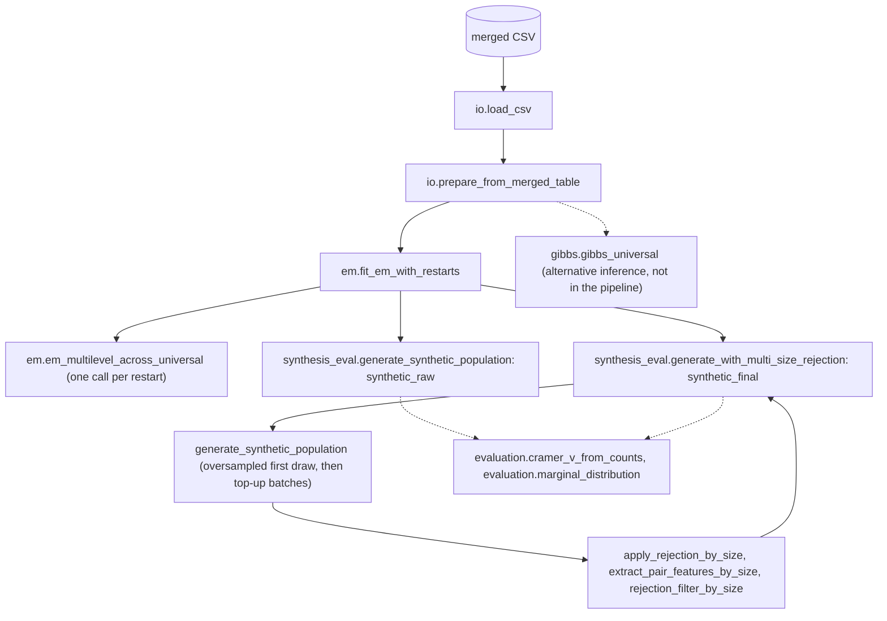

# hlc-popsyn

[](https://github.com/Zhuhan-J/hlc-popsyn/actions/workflows/ci.yml)

hlc-popsyn is an independent Python implementation of the hierarchical mixture model for
population synthesis by Sun, Erath and Cai (2018), "A hierarchical mixture modeling framework
for population synthesis", Transportation Research Part B 114, 199-212. Zhuhan Jin ported it
from the authors' MATLAB code. The package fits household-level and individual-level latent
classes to a merged household-individual table of categorical attributes, generates a synthetic
population of households and their members, and applies a rejection step that corrects
relationships between members of the same household. It is not the authors' official code.

## What the model does

Each household belongs to one of $G$ household latent classes with probability $\pi_g$, and
given its class, each household attribute follows its own categorical distribution. Each member
of a household in class $g$ belongs to one of $M$ individual latent classes with probability
$\pi_{gm}$. The individual classes are universal: all household classes share the same
individual-level attribute distributions, and only the weights $\pi_{gm}$ depend on $g$. Given
its individual class, each individual attribute follows its own categorical distribution, so both
levels are product-multinomial mixtures. The parameters are estimated by EM from several random
starts, keeping the restart with the lowest BIC, and `select_model_grid` repeats this over a grid
of $(G, M)$ values. A Gibbs sampler with Dirichlet-multinomial conjugate updates is included as a
Bayesian alternative that returns posterior-mean parameters. Generation follows the model
directly: draw a household class and its household attributes, then as many members as the
household-size attribute indicates, each with an individual class and individual attributes.
Members are conditionally independent given the household class, so pairwise relationships
such as age gaps are not fully reproduced, and the paper (Sec. 4.4) corrects this with an
acceptance-rejection step on two-person households. This implementation applies the same rule
separately to every household size of two or more (see [Notes on MATLAB parity](#notes-on-matlab-parity))
and redraws households until exactly the requested number is reached.

The log-likelihood that EM maximizes, as computed in `em_multilevel_across_universal`, is

$$
\log L = \sum_{j} \log \sum_{g=1}^{G} \pi_g \prod_{k} \phi^{h}_{k}(x_{jk} \mid g)
\prod_{i \in j} \sum_{m=1}^{M} \pi_{gm} \prod_{l} \phi^{p}_{l}(x_{jil} \mid m),
$$

where $x_{jk}$ is household attribute $k$ of household $j$, $x_{jil}$ is attribute $l$ of
member $i$, and $\phi^{h}_{k}$ and $\phi^{p}_{l}$ are the class-conditional category
probabilities (`log_phi_g` and `log_phi_m` in the code). EM stops when the relative change
$|L_t - L_{t-1}| / |L_{t-1}|$ falls below `tol`. Models are compared with

$$
\mathrm{BIC} = -2 \log L + D_f \log n, \qquad
D_f = (G - 1) + G(M - 1) + G \sum_{k} (d^{h}_{k} - 1) + M \sum_{l} (d^{p}_{l} - 1),
$$

where $n$ is the number of individuals and $d^{h}_{k}$, $d^{p}_{l}$ are the numbers of
categories. In the rejection step, a proposed household with features $(y_1, y_2)$ is accepted
with probability

$$
\alpha(y_1, y_2) = \min\left(1, \frac{f_2(y_1, y_2)}{c \, f_1(y_1, y_2)}\right), \qquad
c = \min\left(3, \max_{y_1, y_2} \frac{f_2(y_1, y_2)}{f_1(y_1, y_2)}\right),
$$

where $f_1$ is the feature distribution of the synthetic households, $f_2$ is the distribution in
the input data, and the maximum runs over cells where both are positive. The paper calls the
constant $c$ "$M$"; it is renamed here to avoid a clash with the number of individual classes.

## Architecture



`pipeline.fit_and_generate` runs the solid path from the prepared arrays onward and returns a
`PipelineResult` with `em_result`, `synthetic_raw` and `synthetic_final`. `runner.main` (the
`hm-popsyn-run` command) adds CSV loading and writes an `.npz` file. Dashed arrows are steps you
call yourself. `kernels.py` holds the low-level helpers used by EM.

## Theory-to-code map

| Paper | Python | MATLAB source |
| --- | --- | --- |
| Model, likelihood and EM updates with universal individual classes (Sec. 3.3-3.4, Eq. 8-13) | `em.em_multilevel_across_universal` | `EM_multilevel_across.m` |
| Parameter count and BIC model selection (Sec. 4.2, Eq. 14) | `em.count_parameters_universal`, `em.bic_score`, `em.fit_em_with_restarts`, `em.select_model_grid` | `run_multilevel_1.m` |
| Bayesian estimation by Gibbs sampling (Sec. 3.3, 4.2) | `gibbs.gibbs_universal` | `Gibbs_universal.m` |
| Generation of households and members (Sec. 4.3, Eq. 2-3) | `synthesis_eval.generate_synthetic_population` | `run_create_2.m` |
| Rejection correction (Sec. 4.4, Eq. 16) | `synthesis_eval.rejection_filter_by_size`, `apply_rejection_by_size`, `generate_with_multi_size_rejection` (`apply_two_person_rejection` is kept as a deprecated alias of `apply_rejection_by_size`) | `run_two_within_the_same_4.m` |
| Evaluation with Cramer's V and marginals (Sec. 4.3-4.4, Eq. 15) | `evaluation.cramer_v_from_counts`, `evaluation.marginal_distribution` | `run_create_2.m`, `run_two_within_the_same_4.m`, `run_draw_figures_3.m` |
| Data preparation (sorting, 1-based codes, one row per household) | `io.prepare_from_merged_table` | `run_multilevel_1.m`, `run_create_2.m` |
| Numerical helpers | `kernels.int_hist`, `sum_eik`, `mnrnd_new`, `logsumexp`, `sumdims` | `int_hist.c`, `sum_eik.c`, `mnrnd_new.m`, `logsumexp.m`, `sumdims.m` |

## Installation

Requires Python 3.10 or newer and NumPy 1.24 or newer.

```bash
git clone https://github.com/Zhuhan-J/hlc-popsyn.git
cd hlc-popsyn
python -m venv .venv
source .venv/bin/activate
pip install -e ".[dev]"
```

## Quick start

Generate the random toy table, then fit and generate with small settings:

```bash
python examples/make_toy_data.py
hm-popsyn-run --input examples/toy_merged.csv --output outputs/toy_result.npz \
    --G 4 --M 6 --n-households 1000 --n-restarts 2 --max-iter 500 --tol 1e-6 --seed 1
```

[examples/README.md](examples/README.md) shows the output of this run and how to inspect the
result file.

### Input format

`hm-popsyn-run` reads a numeric CSV with one header line and one row per individual. With the
default column mapping of `prepare_from_merged_table` (0-based column indices):

| Columns | Content |
| --- | --- |
| 0 | household id |
| 1 | individual id within the household |
| 2, 3, 4, 5 | household attributes; column 5 is the household size and must equal the number of rows of that household |
| 6, 7, 8, 10, 11 | individual attributes |
| 9 | not used |

All values must be integer codes. Each column is shifted so that its minimum becomes 1, and
household ids are remapped to 1..N. The household-size column is used directly as the number of
members to generate, so its codes should be the actual sizes starting at 1.

The rejection step reads individual attribute 0 as an ordinal age code and individual attribute 1
as a second attribute that is mapped to coarse groups. The default lookup tables
`AGE_CODE_TO_ORDER` and `EMPLOY_CODE_TO_GROUP` in `synthesis_eval.py` assume one specific coding.
Codes outside these tables are treated as invalid: such members are ignored, and a household whose
first member, or all of whose other members, are invalid skips the rejection test and is kept. For other
codings, pass your own tables to `fit_and_generate` through `age_code_to_order` and
`employ_code_to_group` (the command-line tool always uses the defaults).

### Command-line options

| Option | Default | Meaning |
| --- | --- | --- |
| `--input` | required | Path to the merged household-individual CSV |
| `--output` | required | Output `.npz` file path |
| `--G` | required | Number of household latent classes |
| `--M` | required | Number of individual latent classes |
| `--n-households` | required | Number of synthetic households to generate |
| `--n-restarts` | 5 | EM restarts; the restart with the lowest BIC is kept |
| `--max-iter` | 1000 | Maximum EM iterations per restart |
| `--concentration` | 1.0 | Scale of the Gamma draws used for random initialization |
| `--tol` | 1e-8 | Relative log-likelihood change that stops EM |
| `--seed` | 12345 | Random seed |
| `--no-rejection` | off | Skip the rejection correction |
| `--initial-oversample` | 1.5 | Multiplier for the first draw when rejection is enabled (at least 1.0) |
| `--topup-factor` | 1.7 | Multiplier for top-up batch size when rejection leaves a shortfall |
| `--max-topup-iters` | 10 | Maximum number of top-up batches before raising an error |

With rejection enabled, the command prints a diagnostic block for every batch (proposed and
accepted households per size, and the constant $c$, shown as `M`).

The `.npz` output holds the fitted parameters `pi_g`, `pi_m`, `log_phi_g` and `log_phi_m`, the
final synthetic population `household_data`, `individual_data`, `individual_group_id`,
`household_class` and `individual_class` (all 1-based), and the EM diagnostics `likelihood` (one
value per iteration) and `converged`. `log_phi_g` and `log_phi_m` are stored as object arrays,
so load the file with `np.load(path, allow_pickle=True)`, and only do so for files you created.

### Python API

Full pipeline and simple checks against the input data (run from the repository root after
creating the toy data):

```python
import numpy as np

from hm_popsyn import (
    cramer_v_from_counts,
    fit_and_generate,
    load_csv,
    marginal_distribution,
    prepare_from_merged_table,
)

data = prepare_from_merged_table(load_csv("examples/toy_merged.csv"))
result = fit_and_generate(
    grpdata=data.grpdata,
    indgid=data.indgid,
    inddata=data.inddata,
    G=4,
    M=6,
    n_households=1000,
    n_restarts=2,
    max_iter=500,
    tol=1e-6,
    seed=1,
)
em, synth = result.em_result, result.synthetic_final
print("converged:", em.converged, "after", em.likelihood.size, "iterations")
print("households:", synth.household_data.shape, "individuals:", synth.individual_data.shape)

# Household-size marginal (household attribute 3) in the input and synthetic data.
print("observed :", marginal_distribution(data.grpdata[:, 3]).round(3))
print("synthetic:", marginal_distribution(synth.household_data[:, 3]).round(3))


def counts(a, b):
    table = np.zeros((a.max(), b.max()))
    np.add.at(table, (a - 1, b - 1), 1)
    return table


# Cramer's V between individual attributes 0 and 1.
v_obs = cramer_v_from_counts(counts(data.inddata[:, 0], data.inddata[:, 1]))
v_syn = cramer_v_from_counts(counts(synth.individual_data[:, 0], synth.individual_data[:, 1]))
print(f"Cramer's V observed={v_obs:.3f} synthetic={v_syn:.3f}")
```

Output, after the rejection diagnostics:

```text
converged: True after 369 iterations
households: (1000, 4) individuals: (2539, 5)
observed : [0.272 0.274 0.184 0.148 0.122]
synthetic: [0.28  0.279 0.178 0.148 0.115]
Cramer's V observed=0.051 synthetic=0.074
```

The toy data are independent random codes, so these numbers only show that the functions run;
they say nothing about fit quality on real data.

Lower-level building blocks:

```python
import numpy as np

from hm_popsyn import (
    generate_synthetic_population,
    gibbs_universal,
    load_csv,
    prepare_from_merged_table,
    select_model_grid,
)

data = prepare_from_merged_table(load_csv("examples/toy_merged.csv"))

# BIC grid search over (G, M); each cell runs fit_em_with_restarts.
best, best_summary, grid = select_model_grid(
    data.grpdata, data.indgid, data.inddata,
    g_values=[2, 4], m_values=[3, 6], n_restarts=1, max_iter=300, tol=1e-6, seed=0,
)
for s in grid:
    print(f"G={s.G} M={s.M} logL={s.best_log_likelihood:.1f} BIC={s.bic:.1f}")
print("selected:", best_summary.G, best_summary.M)

# Draw households from the fitted parameters (no rejection step).
synth = generate_synthetic_population(
    n_households=200,
    pi_g=best.pi_g,
    pi_m=best.pi_m,
    phi_g=[np.exp(x) for x in best.log_phi_g],
    phi_m=[np.exp(x) for x in best.log_phi_m],
    household_size_col=3,
    rng=np.random.default_rng(0),
)
print(synth.household_data.shape, synth.individual_data.shape)

# Gibbs sampler (explicit Python loops over households and individuals; small subset here).
keep = data.indgid <= 50
post = gibbs_universal(
    data.grpdata[:50], data.indgid[keep], data.inddata[keep],
    G=2, M=3, n_iter=60, burn_in=20, thin=5, seed=0,
)
print(post.pi_g_mean.round(3), post.z_trace.shape)
```

Output:

```text
G=2 M=3 logL=-10793.0 BIC=22087.2
G=2 M=6 logL=-10756.1 BIC=22378.5
G=4 M=3 logL=-10768.4 BIC=22224.3
G=4 M=6 logL=-10711.4 BIC=22518.2
selected: 2 3
(200, 4) (505, 5)
[0.543 0.457] (8, 50)
```

## Testing

```bash
pytest
ruff check .
```

The tests use small synthetic arrays defined inline and are written with `unittest`, so pytest
discovers them as they are. Suggested reading order, from building blocks to the full pipeline:

1. `tests/test_kernels.py` checks the MATLAB/MEX helpers in `kernels.py`: 1-based histogram
   counts (`int_hist`), grouped sums by a 1-based mask (`sum_eik`), one-hot categorical sampling
   (`mnrnd_new`), and MATLAB-style summation over dimensions (`sumdims`).
2. `tests/test_em.py` runs `em_multilevel_across_universal` on two small problems and checks the
   shapes of `pi_g`, `pi_m`, `wj` and `x_jik`, that probabilities sum to 1, that responsibilities
   lie in [0, 1], and that the likelihood trace is non-empty and finite.
3. `tests/test_synthesis.py` checks `generate_synthetic_population`: household and individual
   matrix shapes, 1-based class labels within range, and one group id per generated individual.
4. `tests/test_gibbs.py` checks `gibbs_universal`: posterior-mean shapes, trace dimensions, and
   normalization of `pi_g_mean` and `pi_m_mean`.
5. `tests/test_pipeline.py` runs `prepare_from_merged_table` and `fit_and_generate` end to end
   with rejection enabled and checks shapes and the validity of group ids after rejection. With
   these small inputs every household size has fewer than 30 target households, so the sparsity
   guard skips the acceptance test; the test covers the plumbing, not acceptance rates.

## Notes on MATLAB parity

- Category codes are 1-based throughout, as in MATLAB. `prepare_from_merged_table` shifts every
  column so its minimum is 1 (the MATLAB scripts use `bsxfun(@minus, data, min(data)-1)`), sorts
  rows by household and individual id, and remaps household ids to 1..N. Generated
  `household_class`, `individual_class` and `individual_group_id` are 1-based; NumPy indexing
  uses `code - 1` internally.
- The MATLAB scripts read an 11-column table and insert a household-size column computed with
  `int_hist`, giving `grplvl = [3,4,5,6]` and `indlvl = [7,8,9,11,12]`. The Python loader expects
  that size column to be present already, so its default columns (2, 3, 4, 5) and
  (6, 7, 8, 10, 11) are the 0-based equivalents.
- `int_hist` and `sum_eik` reproduce the C MEX files and raise an error on out-of-range codes.
  `logsumexp` reduces over axis 0, matching the MATLAB default `dim = 1`. `sumdims` takes
  MATLAB-style 1-based dimensions.
- EM omits the tensor-based initialization path of `EM_multilevel_across.m`; parameters start
  from normalized Gamma(1, `concentration`) draws. The log-likelihood at each iteration is
  computed from the E-step terms and the updated $\pi_g$, mirroring the MATLAB code. Each restart
  uses its own NumPy generator derived from `seed`, so runs are reproducible in Python but are not
  numerically identical to MATLAB runs, whose random streams differ.
- Rejection differs from the paper and from `run_two_within_the_same_4.m` in these ways:
  - The paper uses the age difference and the sex difference of the two members. This port uses
    the age difference, converted to an ordinal position with `age_code_to_order` and grouped
    into `age_diff_n_bins` bins (default 5), and the difference between group indices of a second
    attribute (`employ_col`, mapped with `employ_code_to_group`). `fit_and_generate` still accepts
    `sex_col` but treats it as a deprecated alias of `employ_col`.
  - The rule is applied separately to each household size of two or more. Features are the mean
    absolute difference between the first listed member and each other member, rounded to an
    integer; for two-person households this equals the single pairwise difference.
  - The constant $c$ is computed over cells where both distributions are positive and is capped
    at 3. Sizes with fewer than `min_target_samples` (default 30) households in the input data
    skip the test, and all their households are accepted.
  - The MATLAB script stacks eight copies of the synthetic two-person rows before rejecting.
    `generate_with_multi_size_rejection` instead draws fresh households (an oversampled first
    draw, then top-up batches) until it has exactly `n_households`, with the household-size mix
    of the first draw, so the output has no duplicated rows.
- `synthetic_raw` in `PipelineResult` is a separate draw of `n_households` without rejection.
  `synthetic_final` is generated independently with its own generator (seed + 1).

## Attribution and license

The model and the original MATLAB implementation are by Lijun Sun, with the paper co-authored
by Alexander Erath and Ming Cai. The MATLAB code is available at
<https://github.com/mcgill-smart-transport/population_synthesis_hierarchical> under the MIT
license. This repository is a Python port of that code and is not maintained by the original
authors. If you use it, please cite the paper ([doi:10.1016/j.trb.2018.06.002](https://doi.org/10.1016/j.trb.2018.06.002)):

```bibtex
@article{sun2018hierarchical,
  title={A hierarchical mixture modeling framework for population synthesis},
  author={Sun, Lijun and Erath, Alexander and Cai, Ming},
  journal={Transportation Research Part B: Methodological},
  volume={114},
  pages={199--212},
  year={2018},
  publisher={Elsevier}
}
```

Citation metadata for this software is in [CITATION.cff](CITATION.cff).

This repository contains no survey data or any other real data. The only data file,
`examples/toy_merged.csv`, is random integer codes generated by `examples/make_toy_data.py`.

Released under the MIT License (see [LICENSE](LICENSE)). The license keeps the original copyright
notice of the MATLAB code (2017, Lijun Sun) and adds one for the Python implementation (2026,
Zhuhan Jin).
